<a href="https://heysaeed.vercel.app/"><picture><source media="(prefers-color-scheme: dark) and (max-width: 600px)" srcset="assets/hero-phone-dark.svg"><source media="(max-width: 600px)" srcset="assets/hero-phone-light.svg"><source media="(prefers-color-scheme: dark)" srcset="assets/hero-dark.svg">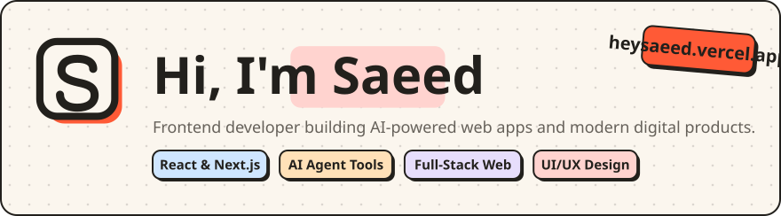</picture></a>

<a href="https://github.com/saeedali780"><picture><source media="(prefers-color-scheme: dark)" srcset="assets/badge-gh-dark.svg"></picture></a>
<a href="https://www.linkedin.com/in/saeedali780"><picture><source media="(prefers-color-scheme: dark)" srcset="assets/badge-li-dark.svg"></picture></a>
<a href="https://x.com/SaeedAli780"><picture><source media="(prefers-color-scheme: dark)" srcset="assets/badge-x-dark.svg"></picture></a>
<a href="https://heysaeed.vercel.app/"><picture><source media="(prefers-color-scheme: dark)" srcset="assets/badge-site-dark.svg"></picture></a>

<picture><source media="(prefers-color-scheme: dark) and (max-width: 600px)" srcset="assets/github-phone-dark.svg"><source media="(max-width: 600px)" srcset="assets/github-phone-light.svg"><source media="(prefers-color-scheme: dark)" srcset="assets/github-dark.svg">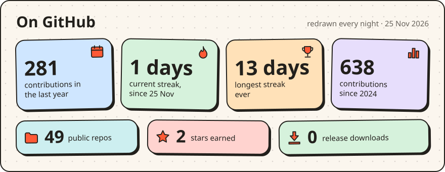</picture>

<picture><source media="(prefers-color-scheme: dark) and (max-width: 600px)" srcset="assets/graph-6m-phone-dark.svg"><source media="(max-width: 600px)" srcset="assets/graph-6m-phone-light.svg"><source media="(prefers-color-scheme: dark)" srcset="assets/graph-6m-dark.svg">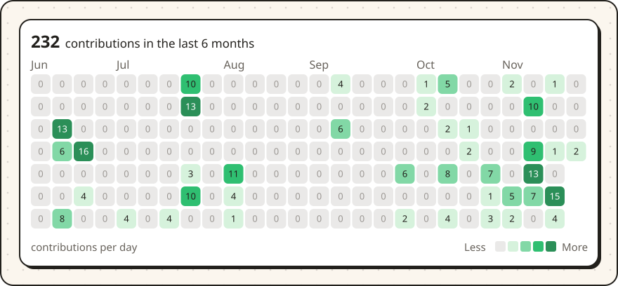</picture>

Last 12 months: 281 contributions

<picture><source media="(prefers-color-scheme: dark) and (max-width: 600px)" srcset="assets/graph-12m-phone-dark.svg"><source media="(max-width: 600px)" srcset="assets/graph-12m-phone-light.svg"><source media="(prefers-color-scheme: dark)" srcset="assets/graph-12m-dark.svg">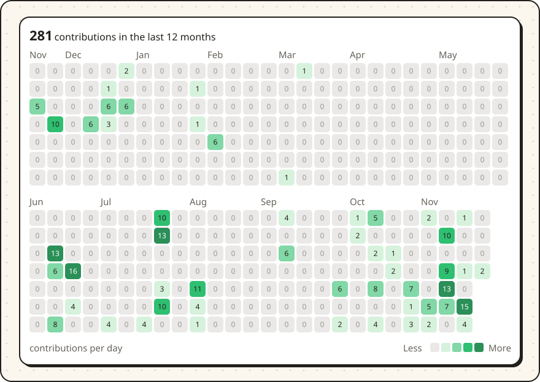</picture>

2026: 242 contributions

<picture><source media="(prefers-color-scheme: dark) and (max-width: 600px)" srcset="assets/graph-2026-phone-dark.svg"><source media="(max-width: 600px)" srcset="assets/graph-2026-phone-light.svg"><source media="(prefers-color-scheme: dark)" srcset="assets/graph-2026-dark.svg">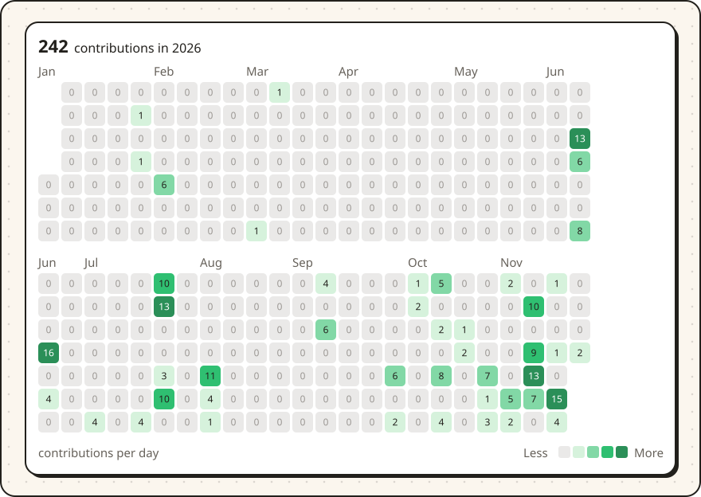</picture>

2025: 396 contributions

<picture><source media="(prefers-color-scheme: dark) and (max-width: 600px)" srcset="assets/graph-2025-phone-dark.svg"><source media="(max-width: 600px)" srcset="assets/graph-2025-phone-light.svg"><source media="(prefers-color-scheme: dark)" srcset="assets/graph-2025-dark.svg">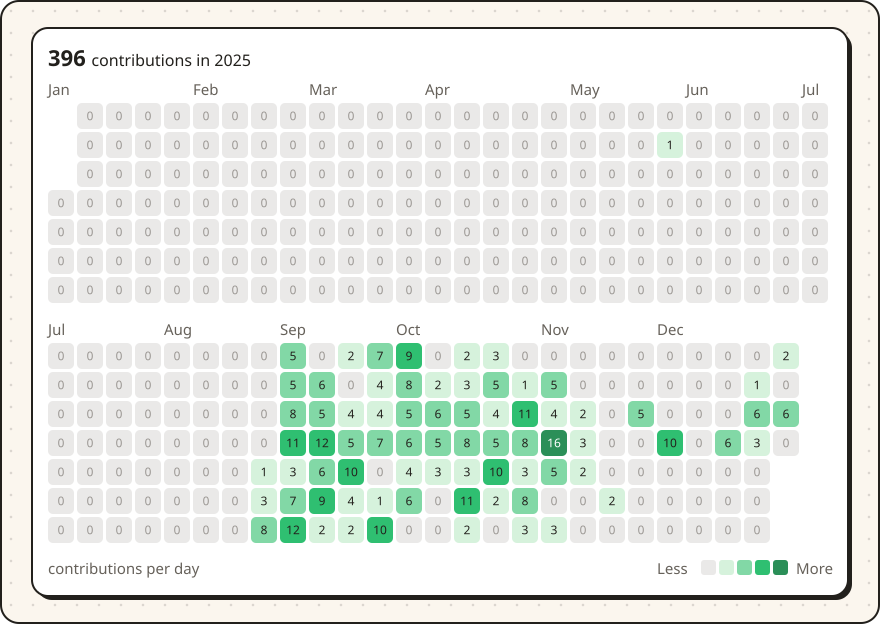</picture>

2024: 0 contributions

<picture><source media="(prefers-color-scheme: dark) and (max-width: 600px)" srcset="assets/graph-2024-phone-dark.svg"><source media="(max-width: 600px)" srcset="assets/graph-2024-phone-light.svg"><source media="(prefers-color-scheme: dark)" srcset="assets/graph-2024-dark.svg">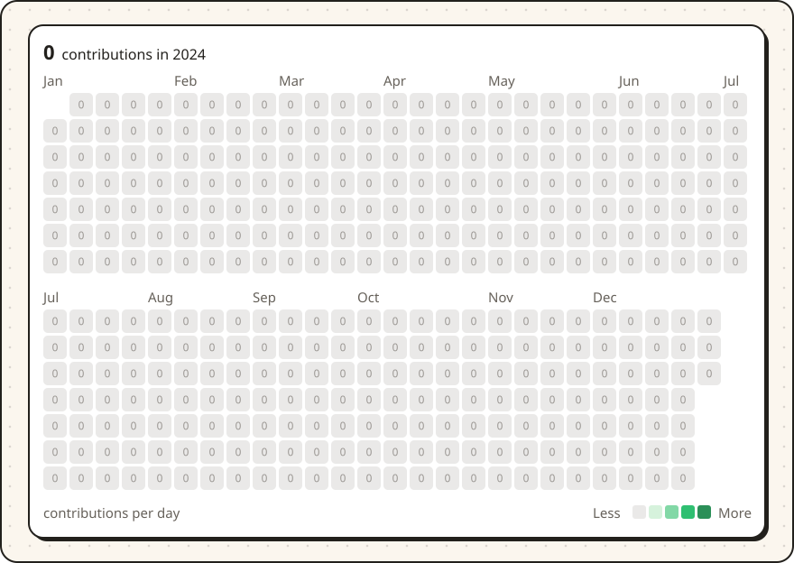</picture>

<picture><source media="(prefers-color-scheme: dark) and (max-width: 600px)" srcset="assets/line-30d-phone-dark.svg"><source media="(max-width: 600px)" srcset="assets/line-30d-phone-light.svg"><source media="(prefers-color-scheme: dark)" srcset="assets/line-30d-dark.svg">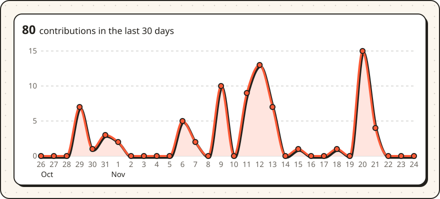</picture>

<picture><source media="(prefers-color-scheme: dark) and (max-width: 600px)" srcset="assets/whoami-phone-dark.svg"><source media="(max-width: 600px)" srcset="assets/whoami-phone-light.svg"><source media="(prefers-color-scheme: dark)" srcset="assets/whoami-dark.svg"></picture>

<picture><source media="(prefers-color-scheme: dark) and (max-width: 600px)" srcset="assets/label-ship-phone-dark.svg"><source media="(max-width: 600px)" srcset="assets/label-ship-phone-light.svg"><source media="(prefers-color-scheme: dark)" srcset="assets/label-ship-dark.svg"></picture>

<a href="https://order-mint-phi.vercel.app/"><picture><source media="(prefers-color-scheme: dark) and (max-width: 600px)" srcset="assets/app-ordermint-phone-dark.svg"><source media="(max-width: 600px)" srcset="assets/app-ordermint-phone-light.svg"><source media="(prefers-color-scheme: dark)" srcset="assets/app-ordermint-dark.svg">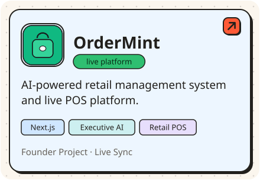</picture></a>
<a href="https://pakistan-legal-rights-agent.vercel.app/"><picture><source media="(prefers-color-scheme: dark) and (max-width: 600px)" srcset="assets/app-legalrights-phone-dark.svg"><source media="(max-width: 600px)" srcset="assets/app-legalrights-phone-light.svg"><source media="(prefers-color-scheme: dark)" srcset="assets/app-legalrights-dark.svg">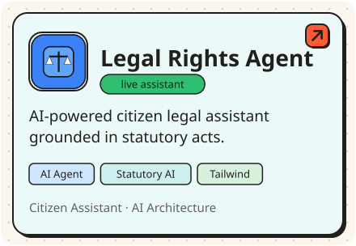</picture></a>
<a href="https://saeedsgpt.netlify.app/"><picture><source media="(prefers-color-scheme: dark) and (max-width: 600px)" srcset="assets/app-chatbot-phone-dark.svg"><source media="(max-width: 600px)" srcset="assets/app-chatbot-phone-light.svg"><source media="(prefers-color-scheme: dark)" srcset="assets/app-chatbot-dark.svg">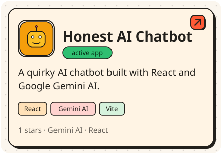</picture></a>
<a href="https://video-downloader-tiktok.netlify.app/"><picture><source media="(prefers-color-scheme: dark) and (max-width: 600px)" srcset="assets/app-tiktok-phone-dark.svg"><source media="(max-width: 600px)" srcset="assets/app-tiktok-phone-light.svg"><source media="(prefers-color-scheme: dark)" srcset="assets/app-tiktok-dark.svg">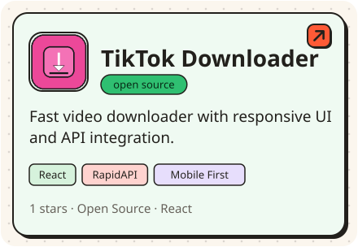</picture></a>

More projects & code: <a href="https://foodiesee.netlify.app/">Food Recipe App</a> · <a href="https://smitquizresults.netlify.app/">SMIT Quiz Results</a> · <a href="https://saeedali780.github.io/MyClubCartAgency/">Digital Agency</a> · <a href="https://github.com/saeedali780/MyBlogUsingReactJS">React Blog</a>

Drawn in Saeed Ali's design system · numbers redrawn every night by a GitHub Action · <a href="https://heysaeed.vercel.app/">heysaeed.vercel.app</a>

